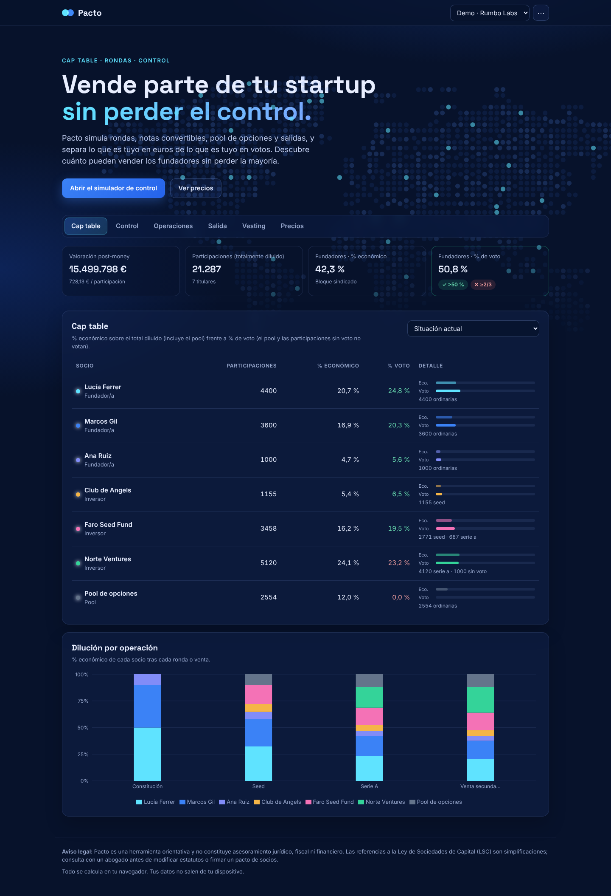
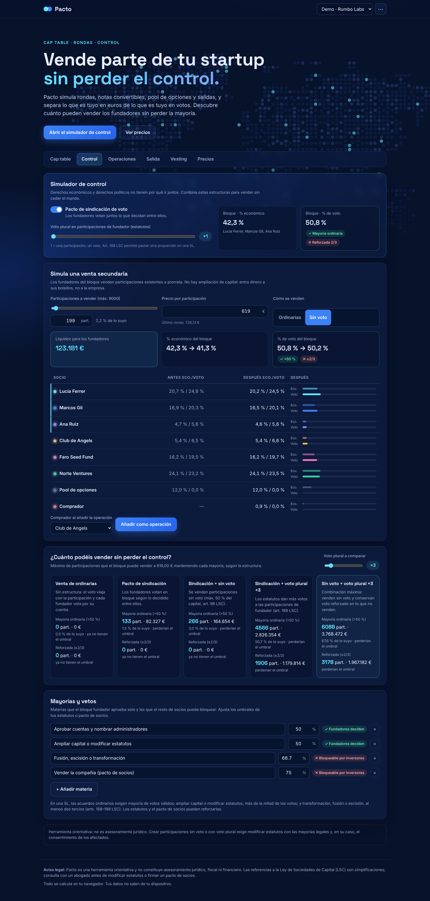

# Pacto · Cap table y control para startups españolas

> Vende parte de tu startup sin perder el control.

**Demo:** https://davidsmarandescu.github.io/Pacto/

Pacto es un simulador de cap table que funciona íntegramente en el navegador. Modela rondas, notas convertibles, pool de opciones, vesting y salidas de una **sociedad limitada española**. Su diferencia: separa los **derechos económicos** de los **derechos políticos** (voto) y calcula cuánto pueden vender los fundadores sin perder la mayoría.



## El problema

Cuando una startup crece, los fundadores quieren algo de liquidez (vender una parte de sus participaciones a un fondo en una venta secundaria) sin perder el control de la compañía. Hoy lo calculan con hojas de cálculo frágiles que:

- mezclan el % económico con el % de voto, como si fueran lo mismo;
- no modelan las herramientas que permite la Ley de Sociedades de Capital (participaciones sin voto, voto plural, sindicación);
- no muestran qué mayorías se pierden tras cada operación hasta que ya está firmada.

## La solución

| Módulo | Qué hace |
|---|---|
| **Cap table** | % económico totalmente diluido frente a % de voto por socio, en cualquier momento de la historia. Gráfico de dilución por operación. |
| **Control** | Simula una venta secundaria, enseña si el bloque fundador conserva la mayoría ordinaria (>50 %) y la reforzada (≥2/3) y compara cuánto se puede vender con cada estructura. |
| **Operaciones** | Constitución, notas o préstamos convertibles (descuento y cap), rondas (pre-money, pool antes o después, preferencia de liquidación) y ventas secundarias. |
| **Salida** | Waterfall con preferencias 1x participativas o no participativas: cuánto cobra cada socio según el precio de venta. |
| **Vesting** | Calendario de consolidación con cliff por fundador. |
| **Precios** | Modelo de negocio (ver abajo). |

### Estructuras de control que compara

1. **Venta de ordinarias**: sin estructura; el voto se va con la participación.
2. **Pacto de sindicación**: los fundadores votan como bloque.
3. **Participaciones sin voto** (art. 98 LSC): se venden derechos económicos sin voto, con el límite de la mitad del capital, que la herramienta comprueba.
4. **Voto plural** (art. 188 LSC): los estatutos de una SL pueden dar más votos a ciertas participaciones.
5. **Combinación**: sin voto más voto plural.

Con los datos de la demo, tras la Serie A los fundadores tienen el **42,3 % económico** y el **50,8 % de los votos**. Vendiendo participaciones ordinarias con sindicación solo pueden vender 133 participaciones sin perder la mayoría. Con sin voto y voto plural ×3 pueden vender **6.088 (≈3,8 M€)** sin perderla.



## Decisiones técnicas

- **Vite + React + TypeScript**, sin backend. Los datos se guardan en `localStorage` (envuelto en `try/catch`) y se exportan o importan en JSON. Argumento comercial: *tus datos no salen de tu dispositivo*.
- **Motor de cálculo puro** en [`src/engine`](src/engine), sin dependencias de React, con tests en Vitest:
  - `captable.ts`: rondas (el pool *pre-money* se resuelve como punto fijo, porque su tamaño cambia el precio), conversión de notas al precio más favorable entre descuento y cap, ventas secundarias, % económico frente a % de voto.
  - `control.ts`: estado de control del bloque fundador y **búsqueda binaria** del máximo vendible que respeta la mayoría y el límite legal de sin voto.
  - `waterfall.ts`: preferencias *pari passu*; las series no participativas convierten de una en una mientras les compense.
  - `vesting.ts`: consolidación lineal mensual con cliff.
- **Recharts** para los gráficos. **Mapa mundi de puntos** generado a partir de una imagen de referencia con [`scripts/dots.py`](scripts/dots.py) (detecta los centros de los puntos y crea un SVG recoloreable).
- Diseño responsive (probado a 390 px de ancho) y hoja de estilos de impresión para exportar a PDF.

### Simplificaciones conocidas

- La preferencia de las notas convertidas se calcula sobre el precio de la ronda (no hay *shadow series*).
- No modela intereses de los préstamos convertibles, *anti-dilution*, ni el precio de ejercicio de las opciones.
- Mayorías legales simplificadas a >50 % y ≥2/3; los estatutos pueden fijar otras.

## Modelo de negocio

| Plan | Precio | Para quién |
|---|---|---|
| Gratis | 0 € | 1 empresa y 1 escenario: cap table, rondas, waterfall básico. Funciona como gancho. |
| Founder | 12 €/mes · 99 €/año | Escenarios ilimitados, simulador de control, exportación para el abogado. Suele contratarse 2–3 meses alrededor de una ronda. |
| Aceleradoras y despachos | desde 149 €/mes | Cartera de startups, marca blanca, plantillas. Ingreso recurrente B2B. |

**Canal:** aceleradoras y despachos que regalan el plan Founder a sus startups, contenido SEO («vender participaciones sin perder el control») y comunidades de fundadores.

**Ventaja:** está pensado para la SL española y su normativa (sin voto, voto plural, mayorías de la LSC), algo que las herramientas internacionales no cubren bien.

## Roadmap

- [ ] Exportar a Excel y generar un borrador de cláusulas de pacto de socios.
- [ ] Concesiones individuales de opciones o *phantom shares* desde el pool, con precio de ejercicio.
- [ ] Cláusulas *anti-dilution* (*full ratchet* y *weighted average*).
- [ ] Cuentas de usuario y escenarios compartidos con inversores (plan Founder).
- [ ] Pagos con Stripe.

## Ejecutar

```bash
npm install
npm run dev        # desarrollo
npm test           # tests del motor
npm run build      # build de producción en dist/
```

Capturas (con `npm run preview` en marcha):

```bash
npm run shots
```

## Aviso legal

Pacto es una herramienta orientativa y **no constituye asesoramiento jurídico, fiscal ni financiero**. Crear participaciones sin voto o con voto plural exige modificar los estatutos con las mayorías legales y, en su caso, el consentimiento de los socios afectados.

## Licencia

Copyright (C) 2026 David Smarandescu

Pacto es software libre: puedes usarlo, estudiarlo, modificarlo y redistribuirlo bajo los términos de la **Licencia Pública General de GNU (GPL), versión 3 o posterior**, publicada por la Free Software Foundation. Si distribuyes una versión modificada, también debe publicarse bajo la GPL con su código fuente.

Se distribuye SIN NINGUNA GARANTÍA. Consulta el archivo [LICENSE](LICENSE) para ver el texto completo.
